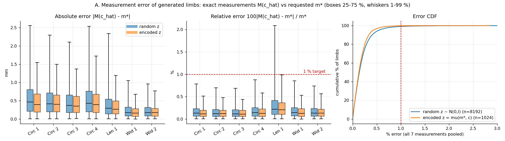
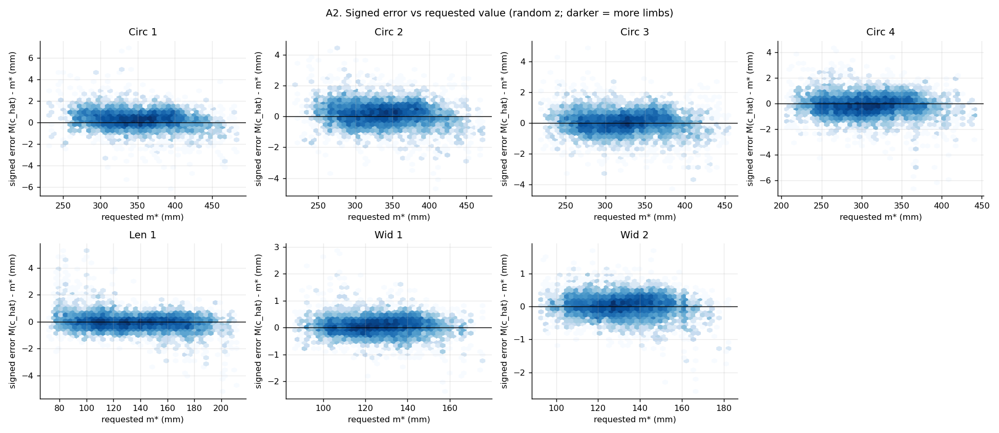
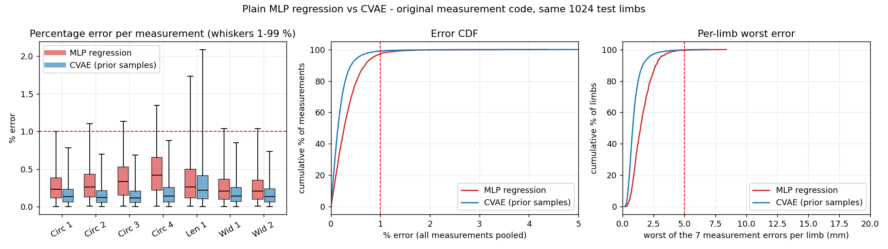
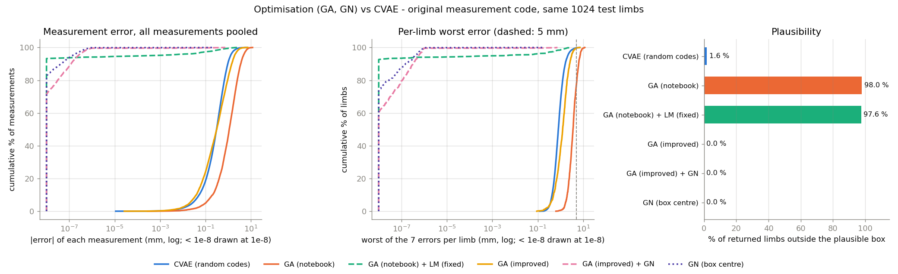
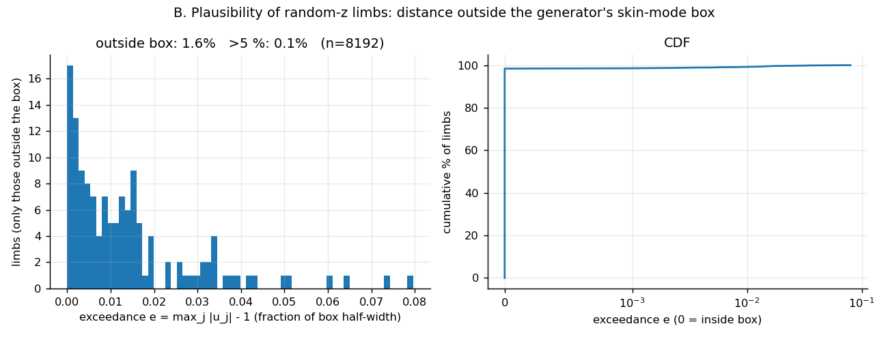
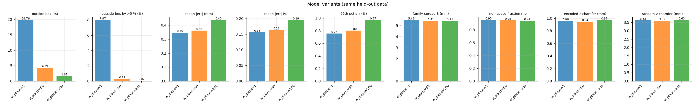
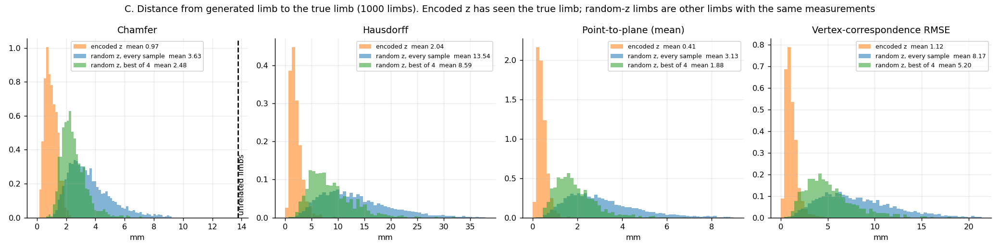
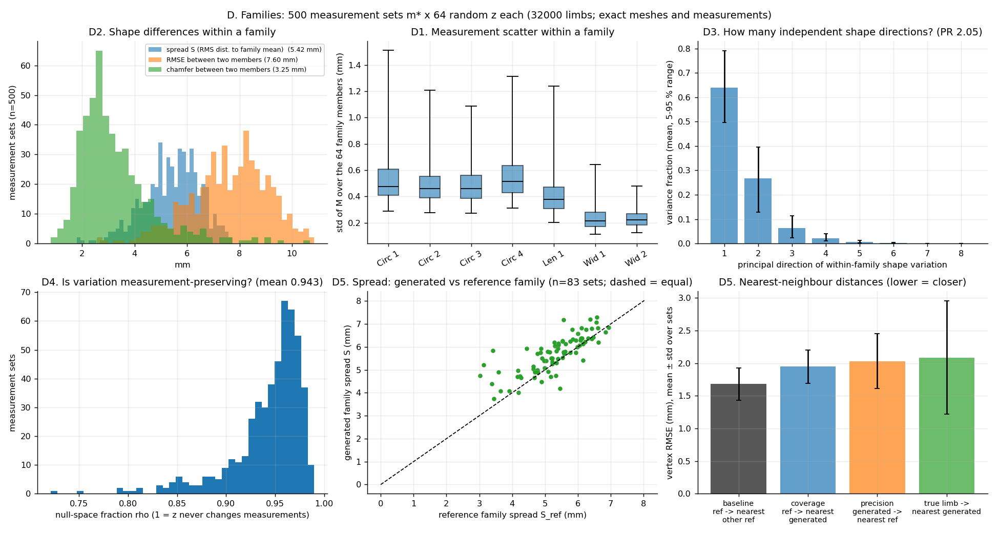
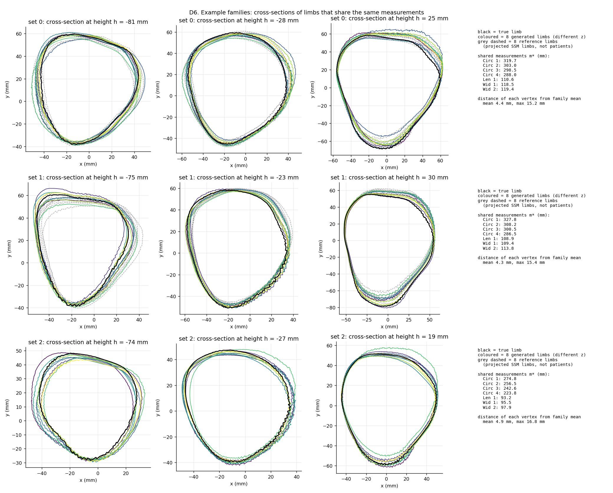
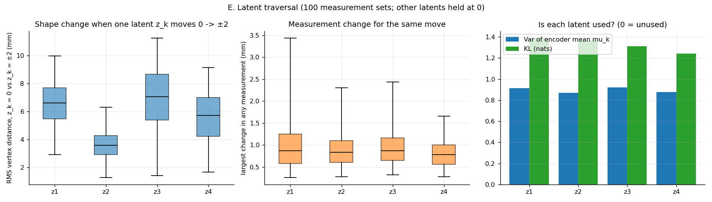

# Generating residual-limb shapes from clinical measurements: the complete guide

*Status: 2026-11-02. All numbers in this document were produced with the corrected measurement code (§2) by models trained under it. To reproduce any of them see [`../README.md`](../README.md).*

**In one sentence:** a neural network takes the seven tape and caliper measurements a clinician records and generates as many different, plausible 3-D residual-limb shapes as you like, every one of which has the requested measurements.

**How to read this.** §1 is the one-page summary. §2–§5 explain *what the code does* (measurements, shape model, networks, training). §6 is how it is evaluated and §7 the results. §8 covers the two experiments for real data (3-D scans with annotation, and CSV tables of measurements). §9 points to the reproduction commands, §10 is the file map and conventions you need to know to modify anything, §11 the limitations.

---

## 1. Summary

1. **Generated limbs have the requested measurements.** Mean error 0.43 mm (0.19 %) over 8192 random-code limbs, judged by the exact measurement code on 1024 limbs from OpenLimbTT's own generator. 0.17 % of limbs have any measurement more than 5 mm off.
2. **The same measurements give genuinely different shapes.** A family member sits 5.4 mm (per vertex) from its family's average while its measurements move by about 0.5 mm. Seven measurements fix about 95 % of OpenLimbTT's shape variance; the families represent the remaining 5 %.
3. **98.4 % of generated limbs are plausible** (inside the region OpenLimbTT's generator can reach).
4. **Against alternatives** (same 1024 test limbs):

   | | mean error | answers per request | time per request |
   |---|---|---|---|
   | **CVAE** (this work) | 0.43 mm | any number | 0.3 ms (1 limb), 0.9 ms (64) |
   | plain MLP, same architecture | 0.81 mm | 1 | 0.3 ms |
   | GA as in the notebook | 1.56 mm | 1 | 46 s as written, 1.4 s fast measure |
   | improved GA | 0.56 mm | 1 | 1.2 s |
   | Gauss–Newton in the plausible box | 0.00007 mm | 1 (or a family from random starts) | 0.11 s |

   The CVAE is about 2× more accurate than the MLP. Optimisation with the exact measurement code is *more* accurate than the CVAE; the CVAE's advantages are speed (~400× per limb, ~10 000× per 64-limb family) and a learnt family.
5. **A measurement bug was found and fixed** (§2.3): the original code made every circumference 4–11 mm (mean 8 mm, 2.4 %) too short. Everything in `claude/` now uses the corrected rule. This changes any number or checkpoint produced before 2026-10-14.
6. **Real-data tooling exists and works on synthetic stand-ins** (§8): a 3-D annotation tool + mesh-vs-ground-truth experiment (`evaluate_wild.py`) and a CSV measurement-consistency experiment (`evaluate_csv.py`). **No real clinical data has been run through them yet.** Scan noise matters a lot (§8.1.6).
7. **Measurements can be missing** (§4.7, §7.11): one network trained with random measurement dropout answers any subset of the 7. With all seven given it is slightly worse than the standard CVAE (0.64 vs 0.44 mm; 4.4 % vs 1.4 % implausible); each missing measurement is inferred to 2–5 mm, except Length 1 (11 mm).

---

## 2. The measurements

### 2.1 Definitions
Seven numbers, in this order everywhere in the code (the model's input order, the CSV column order in the reports, `MEAS_NAMES`):

| # | name | definition (as implemented in `SSM_Driver.get_measurement_details`) |
|---|---|---|
| 0–3 | Circ 1–4 | perimeter of the limb cut by a plane through landmark vertex 4/5/6/7 (proximal → distal) |
| 4 | Length 1 | \|z(vertex 0) − z(vertex 1)\|, along the limb axis |
| 5–6 | Width 1–2 | extent along x of the cut at the plane through landmark vertex 2 / 3 |

In the SSM's own frame the limb axis is z and the width direction x; all planes are horizontal. Units are mm (when `data.scale=true`, the default; the model then also outputs the tibia length so limbs are in real size). The diagram is `measurement_details/image002.png`.

### 2.2 Why it matters how they are measured
The CVAE is trained to hit these numbers, so *what the number means* is part of the model. A scan or a tape measure must give the same quantity as the training code, or the model is fed systematically wrong inputs.

### 2.3 The `0 < t < 1` bug and its fix
`measure_limbs.py` decides an edge is cut by the plane iff its intersection parameter satisfies `0 < t < 1`. Every OpenLimb plane is pinned **exactly through a mesh vertex**, so:
- the edges leaving that vertex have `t = 0` and are not counted, and the triangles touching it lose their segment of the loop (a gap of 2–4 triangle widths);
- any edge lying *in* the plane gives `0/0 = nan` and is discounted too;
- widths additionally take their minimum together with x = 0 (`values *= t_mask` before max − min), so a slice not straddling x = 0 is measured from the origin (effect ≤ 0.1 mm on generated limbs).

**Effect** (300 random OpenLimbTT limbs, corrected minus original): Circ 1–4 longer by +8.6, +7.4, +6.5, +6.7 mm on average (min +4.2, max +11.5; every limb), Length unchanged, Widths +0.006 / +0.002 mm on average (max 0.1).

**Fix** (`data/measure_fixed.py`): a vertex belongs to the "+" side iff its signed distance to the plane is ≥ 0 (a symbolic nudge of the plane by +ε); an edge is cut iff its end points are on different sides. Every triangle then has 0 or 2 cut edges whatever the degeneracy, so the polyline is closed, continuous in the vertices, and equals the exact planar perimeter. Coplanar edges and faces are handled consistently. Widths take the true extent of the cut.

**Where it applies.** `SSMGeometry` (and everything built on it: training data, the surrogate's targets, `generate.py`, all evaluation scripts), `FastMeasure` (same numbers to 1e-13 mm), `evaluate.py`'s reference measurements, and the mesh measurement in `evaluate_wild.py`. `SSM_Driver.py` and `measure_limbs.py` in the repository root are **unchanged** (this work stays inside `claude/`); do not use them for measurements you intend to compare with this model's.

**Consequences you must know about.**
- Checkpoints and `data/surrogate_scaled.pt` produced before the fix are incompatible: they learnt the short circumferences. Retrain both. The surrogate lives at `claude/data/surrogate_scaled.pt`; current checkpoints are `claude/outputs/single/fx_*` (§10).
- The normalisation constants in `data_components/*_measurement_transforms.pt` were computed from the old measurements. They are only means/standard deviations used to standardise inputs; I left them (the circumference means are ~2 % off, which has no practical effect).
- Real data: tape-measure circumferences are true perimeters, i.e. consistent with the corrected rule.

---

## 3. The problem and the shape model

**Why.** Prosthetics research is short of residual-limb shape data. 3-D scans are rare, expensive and identifying; clinics, however, routinely record a handful of measurements. If measurements can be turned into realistic shapes, clinical records become a source of shape data.

**OpenLimbTT** is a published statistical shape model of transtibial residual limbs, built from 33 MRI/CT scans (29 male, 4 female; UK, Australia, USA). A limb is **11 numbers**: 10 shape-mode scores (weights on principal directions of variation) and 1 size number (intact tibia length, 342.8–439.8 mm). From them it builds a mesh of 7732 vertices (15 328 triangles), always the same vertices in the same order. The mesh is the skin surface with the bones removed (`vert_mapping.pt`, `face2vert.pt` in `data_components/`).

**OpenLimbTT's own generator** (`GenerateRandomLimbs.py`) draws 10 "skin-only" mode scores uniformly between the minimum and maximum seen in its 33 scans and maps them to the 11 numbers with a fixed linear regression (`LR.pkl`); tibia length is uniform. I call the reachable region the **plausible box**; a limb is "plausible" if the generator could have produced it. The regression coefficients are extracted to `data/lr_map.npz` so any limb can be mapped back to box coordinates exactly (|u| ≤ 1 ⇔ inside).

**Why one answer is the wrong answer.** Seven measurements cannot fix eleven numbers; about four degrees of freedom remain, so many different limbs share the same measurements.
- **Regression** (NN, MLP) minimises average error, so it returns the *average* of all limbs sharing the measurements, and only one limb. Because circumference is a nonlinear function of shape the average does not in general keep the measurements; in practice this is small (§7.3).
- **The GA** (`genetic_alg.ipynb`) searches the 11 numbers from scratch per request with a small budget and no plausibility constraint; it returns one answer (§7.3).

What we want is a **family**: as many different limbs as asked for, all with the requested measurements, all plausible.

---

## 4. The model

### 4.1 A conditional VAE
The generator (decoder) is a network with two inputs: the 7 requested measurements and a 4-number random **code** z ~ N(0, I). It outputs the 11 limb numbers. 64 limbs for the same measurements = 64 different codes. Four code numbers because 11 − 7 = 4 degrees of freedom are left free (`z_dim`; 0 gives a deterministic regressor).

Training uses a second network, the **encoder**, shown the true limb and its measurements; it outputs the code describing "what is special about this limb beyond its measurements". A **KL term** pushes the codes to be standard-normal-distributed, which is what later lets plain random numbers replace the encoder.

```
TRAINING  (true limb known)
   measurements + true limb ──► encoder ──► code ──┐
                                                   ├──► decoder ──► rebuilt limb  (should equal true limb)
   measurements ───────────────────────────────────┘

USE       (only measurements known)
   random codes ~ N(0, I) ──┐
                            ├──► decoder ──► family of limbs (all should have the requested measurements)
   measurements ────────────┘
```
Terms used below: **random-code limb** (from a random code: normal use) and **encoded-code limb** (from the code the encoder assigns to a known limb: tests whether the decoder *could* represent that limb).

### 4.2 What was added to a standard CVAE
A standard CVAE only ever trains the decoder on encoder codes; nothing checks random codes. In first experiments 20 % of random-code limbs were outside the plausible box. Two losses therefore run the decoder on **random codes** at every step:
- **random-code measurement loss:** the generated limb must have the requested measurements (no true limb exists, so this is the only supervision; it is what makes *every* family member honour the input);
- **plausibility loss:** zero inside the box, squared distance outside (using the exact box test above).

### 4.3 Architecture
Encoder and decoder are residual MLPs: input layer → 256 units, 4 residual blocks (LayerNorm → SiLU → 256×256 linear, added to the input), output layer. Decoder input: 7 measurements + 4-number code. Encoder input: 7 measurements + 11 limb numbers; output: mean and spread of each code number. Everything is standardised (training mean/std; constants in `data_components/`).

### 4.4 The surrogate
The random-code measurement loss needs the gradient of the measurement with respect to the 11 limb numbers, for 512 limbs per step. The exact code is slow (≈4.5 ms per limb in a batch) and piecewise (a plane cutting a mesh has no useful gradient). The **surrogate** is a small separate network (same residual MLP design, width 256, 3 blocks) mapping the 11 numbers to the 7 measurements; fast, smooth, trained once on freshly exact-measured limbs (40 epochs × 30 batches × 256 = 307 200 limbs, MSE on standardised measurements, AdamW, one-cycle LR peaking at 2×10⁻³) and then frozen.

On 1024 held-out limbs its error against the exact (corrected) code is:

| | Circ 1 | Circ 2 | Circ 3 | Circ 4 | Len 1 | Wid 1 | Wid 2 | all |
|---|---|---|---|---|---|---|---|---|
| surrogate mean error (mm) | 0.39 | 0.39 | 0.38 | 0.42 | 0.27 | 0.18 | 0.19 | **0.32** |

During CVAE training the "requested measurements" of each training limb also come from the surrogate (avoiding exact measurement in the loop entirely), so the CVAE learns to satisfy the *surrogate's* idea of the measurements and inherits its error (§7.2). **Every number in this document is measured with the exact code; the surrogate is never used for evaluation.**

### 4.5 Training data
None is stored. Every step draws 512 new limbs with OpenLimbTT's recipe (`ComponentSampler`: skin scores uniform in the box → regression → uniform tibia length). Checked against the original docker generator: means agree within 0.05 standard deviations, spreads within 3 %. Fixed validation (512) and test (1024) sets with exact measurements are built once per run from separate seeds.

### 4.6 Loss, hyperparameters and reasons
Total loss = weighted sum, all on standardised values:

| term | what it asks for | weight |
|---|---|---|
| reconstruction (MSE) | rebuilt limb (encoded code) ≈ true limb | 1 |
| KL | encoder's codes look like N(0, I) | 0.01 (ramped over 20 epochs) |
| encoded-code measurement | rebuilt limb has the right measurements (surrogate) | 1 |
| random-code measurement | random-code limbs have the right measurements (surrogate) | 1 |
| plausibility | random-code limbs stay inside the box | 200 |

| hyperparameter | value | why | tuned? |
|---|---|---|---|
| code size | 4 | = 11 − 7 free degrees of freedom | reasoned |
| KL weight β | 0.01, 20-epoch warm-up | low, so the encoder can carry enough detail; random codes are made valid by the random-code losses, not by a strong KL. Encoder codes still have variance 0.87–0.92 (§7.8) | no |
| loss weights | 1, 1, 1 | neutral | no |
| plausibility weight | 200 | from the sweep in §7.4 | **yes** |
| width / depth | 256 / 4 residual blocks | ample for 11 → 11 | no |
| optimiser | AdamW, lr 10⁻³, weight decay 10⁻⁴ | standard | no |
| schedule | 3-epoch warm-up + cosine to 0 | standard | no |
| gradient clipping | 1.0 | guards against hinge spikes | no |
| batch × steps × epochs | 512 × 100 × 150 (7.7 M fresh limbs) | ~15–25 min on a laptop CPU | no |
| measurement noise | 0 | synthetic measurements are exact. **Must change for real data** (§11) | no |
| checkpoint selection | lowest validation `score` = √recon MSE + prior measurement RMSE + fraction outside box | rewards accuracy, validity, plausibility together | no |

### 4.7 Measurement dropout (optional variant)
Clinics rarely record all seven numbers. The same `LimbCVAE` (`models/lit_cvae.py`) with `model.meas_dropout=true` (default `false`, which gives the plain CVAE of §4.1–4.6) adds a missing-value mask:
- encoder and decoder receive `[m · mask, mask]` (a missing measurement is zeroed, i.e. the population mean, and flagged), so one network serves every pattern from "all 7" to "none" (an unconditional limb sampler);
- per training sample, with probability `p_full` = 0.2 all seven are kept, otherwise *k* ~ U{`min_keep`, …, 6} (`min_keep` = 0) are kept, a uniformly random subset;
- the two measurement losses (encoded-code and random-code) score **observed entries only**; reconstruction, KL and plausibility are unchanged, so missing measurements are constrained only by what the training distribution implies;
- validation `score` is computed under fixed random masks (`val/full_*` = all given). Everything else, including data, surrogate, schedule and weights, is as in §4.6.

---

## 5. Using the model

```bash
python claude/data/generate.py ckpt=<best.ckpt> measurements=[300,290,280,270,120,110,115] n_samples=32 save_meshes=true
```
Measurements are in mm in the order Circ 1–4, Length 1, Width 1, Width 2. With a measurement-dropout checkpoint a measurement may be left out: `measurements=[300,null,280,null,120,110,null]`. It writes `components.npy` (n × 11), `measurements_check.json` (requested vs exact re-measured), optionally one `.obj` per limb. `temperature<1` shrinks the family; `reject_implausible=true` (default) resamples until every limb is inside the box. Because every generated limb can be re-measured exactly, any outlier can be detected and discarded.

---

## 6. How the model is evaluated

`evaluate.py` deliberately avoids anything written for training:
- **Test limbs:** 1024 limbs from OpenLimbTT's **original** generator run in docker (`openlimbtt-env`), none used in training.
- **Requests:** the exact measurements of each test limb.
- **Judging:** meshes through the original `get_verts`, measurements through the (corrected) exact code.

| | question | size |
|---|---|---|
| A | Do generated limbs have the requested measurements? | 1024 requests × 8 random codes = 8192 limbs |
| B | Are they plausible? | the same 8192 |
| C | Could the decoder represent a specific real limb? | 1000 test limbs |
| D | For one request, are family members genuinely different? | 500 requests × 64 codes = 32 000 limbs |
| E | Does each code number do something? | 100 requests |

**Shape distances** (mm): *vertex RMSE* (vertex *i* vs vertex *i*, RMS 3-D distance); *chamfer* (mean nearest-vertex distance both ways, ignores sliding, always ≤ vertex RMSE); *Hausdorff* (worst nearest-vertex distance); *point-to-plane* (like chamfer but only the component perpendicular to the surface); *family spread* (vertex RMSE of a member to its family's average, averaged over members).

---

## 7. Results (synthetic OpenLimbTT limbs, corrected measurement)

### 7.1 Generated limbs have the requested measurements
8192 random-code limbs, exact code:

| measurement | typical (mm) | mean error (mm) | worst (mm) | bias (mm) | mean (%) | worst (%) |
|---|---|---|---|---|---|---|
| Circ 1 | 350 | 0.59 | 6.90 | +0.26 | 0.17 | 2.04 |
| Circ 2 | 337 | 0.52 | 4.69 | +0.15 | 0.16 | 1.60 |
| Circ 3 | 323 | 0.48 | 4.88 | +0.03 | 0.15 | 1.76 |
| Circ 4 | 307 | 0.56 | 6.66 | −0.16 | 0.19 | 1.82 |
| Len 1 | 135 | 0.42 | 5.28 | −0.06 | 0.33 | 6.31 |
| Wid 1 | 126 | 0.23 | 2.86 | +0.05 | 0.19 | 2.67 |
| Wid 2 | 132 | 0.23 | 2.58 | +0.02 | 0.17 | 1.60 |
| **all** | | **0.43** | 6.90 | +0.04 | **0.19** | 6.31 |

Over all 57 344 measurements the median error is 0.31 mm and 99 % are within 2.2 mm (0.97 %). Per limb, worst of its 7: **0.17 %** have any measurement > 5 mm off; **5.2 %** have any > 1 % off. Encoded-code limbs (1024): mean 0.37 mm, worst 2.85 mm. Bias is at most 0.26 mm (small positive circumference bias at the proximal end).


*Left: absolute error per measurement; middle: percentage, 1 % target in red (boxes = middle 50 %, line = median, whiskers 1st–99th percentile; blue = random codes, orange = encoded codes). Right: cumulative distribution of percentage error.*


*Signed error (generated − requested) against the requested value; darker = more limbs.*

### 7.2 Accuracy is limited by the surrogate
| | Circ 1 | Circ 2 | Circ 3 | Circ 4 | Len 1 | Wid 1 | Wid 2 | all |
|---|---|---|---|---|---|---|---|---|
| surrogate vs exact (mm) | 0.39 | 0.39 | 0.38 | 0.42 | 0.27 | 0.18 | 0.19 | 0.32 |
| CVAE, encoded code (mm) | 0.48 | 0.47 | 0.43 | 0.47 | 0.35 | 0.19 | 0.21 | 0.37 |
| CVAE, random code (mm) | 0.59 | 0.52 | 0.48 | 0.56 | 0.42 | 0.23 | 0.23 | 0.43 |

The CVAE is doing what it was asked (satisfy the surrogate) and the residual is dominated by the surrogate's own error; random codes add ~0.06 mm. The most direct route to better accuracy is a better surrogate or short fine-tuning against exact measurements. At 0.43 mm against a 5 mm target this is not a priority.

### 7.3 Against a plain MLP and against optimisation
All methods use **the same 1024 test limbs** and the same statistics.

**How the comparison methods were built.**
- **Plain MLP:** the CVAE decoder with the code removed: same residual MLP, optimiser, schedule, seed and data (measurements from the same surrogate); only loss is MSE on the limb numbers. `model=mlp`.
- **GA as in the notebook:** `genetic_alg.ipynb`'s pygad set-up unchanged: 32 candidates × 50 generations, genes = standardised limb numbers in [−3, 3], steady-state selection of 4 parents, single-point crossover, "random" mutation of 20 % of genes; fitness = −mean squared *relative* measurement error. Problems found by reading the notebook and pygad: (1) with a `gene_space`, "random" mutation *replaces* genes with fresh uniform draws, so the search cannot fine-tune; (2) ±3σ boxes are mostly outside the plausible region (98 % of its answers are outside it, by a median 65 % of the box half-width); (3) its Levenberg–Marquardt refinement never had an effect (standardised numbers passed to a function expecting raw ones, a mis-shaped and sign-flipped Jacobian, and the refined limb was only printed); (4) it measures the true limb again at every fitness call, one limb at a time (46 s per request as written).
- **Improvements, none changing the objective** (`models/ga.py`, `fast_measure.py`): faster exact measurement (same formulas on the band of edges a plane can reach, verified per limb, falling back to the exact code; matches to 1e-13 mm; 5–8× faster per limb in batches, *a speed figure from before the fix; not re-benchmarked*); an **improved GA** (genes = the generator's box coordinates in [−1, 1] so every candidate is plausible, Gaussian mutation shrinking from 0.3 to 0.03 half-widths on 30 % of genes, per-gene blend crossover, 8 parents, 2 elites; settings chosen on 48 separate development limbs, *not re-tuned after the fix*); the **notebook's LM refinement fixed**; and **Gauss–Newton (GN) inside the box** (smallest step removing the linearised relative error via pseudo-inverse, step limited to the box and halved until the error drops, Jacobian by finite differences, untuned), run from the improved GA's answer, from the **box centre** (no GA), and from **8 random plausible limbs** (a family).

**Evidence** (exact code; mm; `report/eval_reports/ga.txt`, `mlp.txt`):

| method | mean | median | 99 % within | worst | any > 5 mm | any > 1 % | outside box | measurements/request |
|---|---|---|---|---|---|---|---|---|
| GA (notebook), rerun | 1.56 | 1.10 | 6.87 | 11.8 | 23.1 % | 76.3 % | 98.0 % | 1582 |
| + its LM refinement, fixed | 0.016 | < 10⁻⁹ | 0.50 | 2.66 | 0 % | 0.2 % | 97.6 % | 1831 |
| GA (improved) | 0.56 | 0.31 | 3.04 | 7.24 | 0.4 % | 5.4 % | **0 %** | 1530 |
| GA (improved) + GN | 0.0008 | < 10⁻⁹ | < 10⁻⁶ | 0.74 | 0 % | 0 % | **0 %** | 1621 |
| **GN from the box centre** | **0.00007** | < 10⁻⁹ | < 10⁻⁶ | **0.19** | **0 %** | **0 %** | **0 %** | **96** |
| GN from 8 random plausible limbs | 0.0074 | < 10⁻⁹ | < 10⁻⁶ | 18.5 | 0.09 % | 0.2 % | 0 % | 111 per limb |

Against the learnt models:

| | **CVAE** | **MLP** | **GA (notebook)** | **GA (improved)** | **GN, box centre** | **GN, random starts** |
|---|---|---|---|---|---|---|
| mean error | 0.43 mm (0.19 %) | 0.81 mm (0.33 %) | 1.56 mm (0.65 %) | 0.56 mm (0.21 %) | **0.00007 mm** | 0.007 mm |
| median error | 0.31 mm | 0.56 mm | 1.10 mm | 0.31 mm | < 10⁻⁹ | < 10⁻⁹ |
| 99 % of measurements within | 2.2 mm | 3.4 mm | 6.9 mm | 3.0 mm | < 10⁻⁶ | < 10⁻⁶ |
| worst error | 6.9 mm (6.3 %) | 8.4 mm (4.4 %) | 11.8 mm (4.6 %) | 7.2 mm (2.1 %) | 0.19 mm | 18.5 mm (5.3 %) |
| any > 5 mm off | 0.17 % | 0.49 % | 23.1 % | 0.4 % | 0 % | 0.09 % |
| any > 1 % off | 5.2 % | 10.5 % | 76.3 % | 5.4 % | 0 % | 0.2 % |
| outside plausible box | 1.6 % | 0.6 % (not enforced) | 98.0 % | 0 % | 0 % | 0 % |
| answers per request | any number | 1 | 1 | 1 | 1 | any number |
| time (laptop CPU) | **0.29 ms (1 limb), 0.88 ms (64)** | 0.35 ms | 46 s as written, 1.4 s fast | 1.2 s | 0.11 s | ≈ 0.1 s per limb |
| chamfer to the true limb | 3.63 mm per random-code member; 2.48 best of 4 | 2.85 mm | 7.03 mm | 3.99 mm | 3.06 mm | — |
| family of 8, 500 requests: spread / true → nearest member | 5.10 / 3.92 mm | — | — | — | — | 5.80 / 3.81 mm |




*Cumulative distributions of measurement error on a log scale (errors below 10⁻⁸ mm drawn at 10⁻⁸); right: share of returned limbs outside the box.*

**Analysis.**
- **CVAE vs MLP.** The CVAE is ~2× more accurate on mean, median and 99th-percentile error and has 0.17 % vs 0.49 % of limbs with any measurement > 5 mm off. The MLP's signed errors are biased towards smaller-than-requested circumferences (−0.45, −0.56, −0.82, −1.12 mm for Circ 1–4): the "average of several limbs" effect of §3, small but systematic. The MLP's single answer is close to the true limb (2.85 mm chamfer, closer than a typical CVAE member at 3.63 mm; expected, the average minimises squared error) but it cannot show the 5.4 mm of shape variation the measurements allow. *The CVAE differs from the MLP in two ways at once (a code, and extra losses), which I did not separate (§11).*
- **The notebook GA was limited by its set-up, not the idea.** Same library, objective and budget, changing only search space and operators: mean error 1.56 → 0.56 mm, limbs with any measurement > 1 % off 76 % → 5 %, every answer plausible. A pure GA at this budget remains less accurate than the CVAE.
- **The problem is almost linear, so local least squares solves it.** GN from the box centre needs ~4 iterations (96 measurements) and matches every measurement to within 0.001 mm on essentially all requests (worst 0.19 mm). Starting from the GA's answer does not help (17× more expensive, slightly less reliable). **For this problem the GA is unnecessary.**
- **Why optimisation beats the CVAE on accuracy:** it uses the exact measurement at every step; the CVAE inherits the surrogate's ~0.3 mm. The requests are also exactly reachable (they come from OpenLimbTT limbs). For clinical measurements OpenLimbTT cannot reach exactly, GN would return the closest plausible least-squares fit (untested).
- **What the CVAE offers:** speed (0.3 ms vs 0.1 s per limb; 0.9 ms vs ~7 s for 64) and a *learnt* conditional distribution. GN from random starts also gives a family (spread 5.80 vs the CVAE's 5.10 mm, similar nearest-member distance) but fails more often (0.9 % of runs stall) and its distribution is "wherever the starts are projected". Which better describes "limbs with these measurements" is not tested.

*Caveats.* GA settings tuned on 48 development limbs, one run per setting (before the fix, not repeated); GN untuned; CVAE and MLP untuned apart from the plausibility weight; optimisation times are single-request on a 16-thread CPU; one training run per model.

### 7.4 Plausibility, and what it costs
Full evaluation of three plausibility weights (1024 test limbs, 8 random codes; `report/figs/compare_variants.md`):

| plausibility weight | outside box | outside by > 5 % of box width | mean error | 99th-pct error | family spread |
|---|---|---|---|---|---|
| 1 | 19.8 % | 8.0 % | 0.346 mm | 0.76 % | 5.49 mm |
| 50 | 4.4 % | 0.27 % | 0.360 mm | 0.80 % | 5.41 mm |
| **200 (final)** | **1.6 %** | **0.07 %** | 0.435 mm | 0.97 % | 5.42 mm |

Quick end-of-training checks (1 limb per request, validation/test split inside training, so not comparable with the table above): outside box 21.2 / 9.7 / 4.9 / 2.6 % and exact prior MAE 0.36 / 0.37 / 0.38 / 0.46 mm for weights 1 / 10 / 50 / 200.


*Left: for the limbs outside the box, how far outside (fraction of the box half-width). Right: cumulative over all limbs; the jump at 0 shows the share inside.*



**Analysis.** Weight 1 → 200 cuts implausible limbs twelvefold (19.8 → 1.6 %) and the remaining ones are barely outside (worst 8 % of the half-width), at a cost of +0.09 mm mean error (this is a larger cost than before the fix, when it was +0.02 mm; the variation between single training runs is not known). Diversity is essentially unchanged, so the penalty removes implausible shapes without shrinking the family. When a request sits near the edge of what OpenLimbTT can represent, plausibility and measurement compete and the model trades a little accuracy to stay plausible. Weight 50 is the better accuracy/plausibility compromise if 4 % implausible is acceptable.

### 7.5 The decoder can represent any specific limb to about 1 mm
Distance from generated limbs to the true test limb (1000 limbs, mean ± std, mm):

| generated from | chamfer | Hausdorff | point-to-plane | vertex RMSE |
|---|---|---|---|---|
| encoded code (has seen the true limb) | 0.97 ± 0.41 | 2.04 ± 1.08 | 0.41 ± 0.20 | 1.12 ± 0.60 |
| random code, every limb | 3.63 ± 1.59 | 13.5 ± 7.1 | 3.13 ± 1.69 | 8.17 ± 4.10 |
| random code, closest of 4 | 2.48 ± 0.83 | 8.59 ± 4.15 | 1.88 ± 0.91 | 5.20 ± 2.62 |
| *for scale: two unrelated limbs* | *13.8* | | | |



The encoded-code row is the decoder's *capacity*. The random-code rows are **not errors**: a random-code limb is meant to be a *different* limb with the same measurements. They show the family stays in the true limb's neighbourhood (3.6 mm vs 13.8 mm for unrelated limbs); the closest of just 4 draws is usually within 2.5 mm chamfer.

### 7.6 The same measurements give genuinely different shapes
500 requests × 64 codes:
- **Shape moves:** family spread **5.42 mm** (95 % of families 3.2–7.2 mm); two random members differ by 7.6 mm vertex RMSE and 3.2 mm chamfer; the most different pair in a family is typically 20 mm apart.
- **Measurements stay put:** the standard deviation across a family's 64 members is 0.50–0.56 mm for the circumferences, 0.43 mm for length, 0.24 mm for widths (0.15–0.34 %).


*D1 (top-middle): variation of each measurement within a family. D2 (top-left): three ways of measuring shape difference within a family. D3–D5: §7.7–7.8.*


*Each row is one request; three horizontal slices of the limbs. Black: true test limb; coloured: 8 generated limbs; grey dashed: 8 limbs of the independent reference family (§7.7). Every outline in a row has the same seven measurements.*

Shape varies ~10× more than the measurements do. The example slices show where the freedom lies: mainly the front–back profile and the distal end, not size (the measurements already fix size).

### 7.7 The variation is the right kind, and its width agrees with an independent construction
- **Measurement-preserving directions (D4).** At each family's mean limb, the 4 directions (11 − 7) that to first order change no measurement contain on average **94.3 %** of the family's variance.
- **Dimensionality (D3).** PCA of each family's meshes: variance split 64 / 27 / 6 / 2 % over the first four directions; three capture 95 %; participation ratio 2.05. One of the four free directions carries little shape change for most requests (OpenLimbTT's later modes are small); all four code numbers are nonetheless used (§7.8).
- **Independent reference family (D5).** For 100 requests: draw 300 random plausible limbs, push each onto the requested measurements by Gauss–Newton, discard any outside the box, keep those matching within 1.5 mm. 83 requests kept ≥ 20 limbs (about 90 on average). Spread: CVAE 5.68 vs reference 5.29 mm (CVAE ≈ 7 % wider); reference limb → nearest CVAE limb 1.95 mm (density baseline, reference → nearest other reference: 1.68 mm); CVAE limb → nearest reference limb 2.03 mm; true limb → nearest of 64 CVAE limbs 2.09 mm (95 %: 0.89–4.15). The CVAE covers the reference family almost as densely as the reference covers itself and does not invent shapes the reference would never reach. The reference is itself a heuristic, so this is corroboration, not proof.

### 7.8 All four code numbers are used
Code number set to ±2 with the others at 0 (100 requests): shape change 6.5, 3.6, 6.9, 5.6 mm (vertex RMSE); mean largest measurement change 0.8–1.0 mm (worst single 5.2 mm). Encoder code variance 0.87–0.92 and KL 1.2–1.4 nats per number (an ignored number would sit near 0). No posterior collapse; the codes behave like standard-normal noise, supporting the low KL weight.



### 7.9 Seven measurements determine ~95 % of OpenLimbTT's shape variation
A typical vertex is 24.9 mm from the average limb across the population; 5.4 mm from the family average within a family sharing the measurements. (5.4/24.9)² ≈ 4.7 % of the variance is left; the measurements account for ~95 %. This is relative to OpenLimbTT, not to real anatomy.

### 7.10 Before vs after the measurement fix
Same architecture, protocol and test limbs; everything retrained. (The "before" column is from the earlier, pre-correction write-up, which is no longer kept.)

| | before | after |
|---|---|---|
| surrogate mean error (mm) | 0.32 | 0.32 |
| CVAE mean error, random codes (mm / %) | 0.37 / 0.17 | 0.43 / 0.19 |
| CVAE outside box (w = 200) | 2.1 % | 1.6 % |
| family spread (mm) | 5.43 | 5.42 |
| plain MLP mean error (mm) | 0.72 | 0.81 |
| GA (notebook) mean error (mm) | 1.54 | 1.56 |
| GA (improved) mean error (mm) | 0.55 | 0.56 |
| GN from box centre mean error (mm) | 0.0001 | 0.00007 |

The correction does not change the conclusions. The small CVAE/MLP accuracy loss is within what single untuned training runs can vary by, but I have not measured that variation.

### 7.11 Missing measurements (dropout model)
`evaluate_dropout.py`: 1024 held-out limbs from this package's sampler (fixed seed, exact measurements; not the docker generator), 4 random-code limbs per limb and pattern, final model trained as in §4.7 for 150 epochs (`report/eval_reports/dropout.txt`). "obs" / "miss" = mean absolute error (mm) of the exact re-measured limb on the measurements that were given / left out. "Family std" = per-vertex standard deviation (mm) over the 4 samples of one request, on 100 limbs.

**All seven, and one dropped at a time.**

| pattern | obs MAE | miss MAE | outside box | vertex RMSE to true limb | family std |
|---|---|---|---|---|---|
| all 7, standard CVAE (`fx_w200`) | 0.44 | – | 1.4 % | 5.28 | 2.83 |
| all 7, dropout model | 0.64 | – | 4.4 % | 5.53 | 3.02 |
| drop Circ 1 | 0.70 | 3.46 | 3.7 % | 6.24 | 3.65 |
| drop Circ 2 | 0.69 | 2.08 | 3.7 % | 6.05 | 3.23 |
| drop Circ 3 | 0.67 | 2.21 | 3.0 % | 5.73 | 3.19 |
| drop Circ 4 | 0.68 | 5.36 | 2.8 % | 5.73 | 3.06 |
| drop Length 1 | 0.75 | 11.48 | 3.2 % | 8.15 | 4.01 |
| drop Width 1 | 0.80 | 2.11 | 3.6 % | 6.11 | 3.15 |
| drop Width 2 | 0.79 | 2.40 | 3.8 % | 5.85 | 3.19 |

**k measurements given** (random subsets, 8 masks per limb):

| k | obs MAE | miss MAE | outside box | vertex RMSE | family std |
|---|---|---|---|---|---|
| 6 | 0.72 | 4.16 | 3.6 % | 6.32 | 3.38 |
| 5 | 0.79 | 4.99 | 2.3 % | 7.17 | 3.75 |
| 4 | 0.84 | 6.14 | 1.7 % | 8.14 | 4.26 |
| 3 | 0.92 | 8.01 | 1.4 % | 9.69 | 4.94 |
| 2 | 1.00 | 11.01 | 1.1 % | 12.25 | 5.88 |
| 1 | 0.87 | 17.54 | 0.5 % | 15.84 | 7.25 |
| 0 | – | 33.40 | 0.0 % | 18.92 | 8.88 |

**Analysis.**
- **The observed measurements are still honoured** (0.6–1.0 mm whatever else is missing) and the family widens as information is removed (3.0 → 8.9 mm per vertex from seven given to none), which is the intended behaviour: the free degrees of freedom grow and the code carries them.
- **Missing measurements are inferred, not guessed**: dropping any one circumference or width costs 2–5 mm on that measurement (the other six largely determine it); dropping Length 1 costs 11 mm because nothing else in the set carries the limb's length. With none given the error is 33 mm, the population spread.
- **The price of generality**: with all seven given the dropout model is worse than the dedicated CVAE (0.64 vs 0.44 mm; 4.4 vs 1.4 % outside the box). Capacity is shared across 2⁷ patterns and 80 % of training samples are masked. Raising `p_full` or `w_plaus` are the obvious first remedies; neither was tried.
- **Plausibility** is best when few measurements are given (nothing competes with the box) and worst with all seven (4.4 %).
- *Single training run, no tuning of `p_full`, `min_keep` or the weights. This evaluation draws its own test limbs, so the standard CVAE's 0.44 mm differs slightly from §7.1's 0.43 mm.*

---

## 8. Real-data experiments

Both scripts are driven by hydra `key=value` overrides, their configs are defined inside the files (`CONFIG`), and they write to `claude/outputs/…/<timestamp>/` (override with `out_dir=`). Full run outputs of the synthetic tests are in `report/eval_reports/wild_synthetic*.txt` and `csv_synthetic.txt`.

### 8.1 `evaluate_wild.py`: meshes with ground-truth shape

**Question.** Given a real 3-D limb (any pose, any tessellation), measure it with the OpenLimb definitions, feed the seven numbers to the CVAE, and compare the generated family with the real shape.

#### 8.1.1 Modes
```bash
python claude/evaluation/evaluate_wild.py mode=make_test_data mesh_dir=<dir> n_test=20 [noise_mm=0.3] [retessellate=true]
python claude/evaluation/evaluate_wild.py mode=annotate       mesh_dir=<dir>               # 3-D annotation tool in the browser
python claude/evaluation/evaluate_wild.py mode=evaluate ckpt=<best.ckpt> mesh_dir=<dir> [k_samples=16 align=icp ...]
```
Meshes: any format `igl.read_triangle_mesh` reads (obj, stl, ply, off, mesh); `unit_scale` converts to mm (e.g. 1000 for metres). `make_test_data` generates OpenLimbTT limbs, applies a random rigid pose and optionally a 4× re-tessellation and Gaussian vertex noise, and writes exact annotations (and `reference_measurements`, `true_components`); it is the stand-in until real scans exist.

#### 8.1.2 Annotation
The measurement planes cannot be defined by a single vertex on an arbitrary pose, so the annotation is geometric:
- **Circ 1–4:** 3 points on each circumference plane (any 3 around the limb; the plane is through them);
- **Width 1–2:** 2 points, the medial and lateral extremes of the slice;
- **Length 1:** 2 end points.

File `<mesh stem>.json` next to the mesh (or in `ann_dir`), coordinates in mm in the frame of the (unit-scaled) mesh:
```json
{"version": 2,
 "planes": {"circ1": [p,p,p], "circ2": [p,p,p], "circ3": [p,p,p], "circ4": [p,p,p]},
 "widths": {"width1": [p,p], "width2": [p,p]},
 "length1": [p,p],
 "reference_measurements": [7 numbers, optional]}
```
**Definitions used.** The limb **axis** is the mean of the four plane normals, each sign-aligned to Circ 1's. Circ *i* = perimeter of the mesh cut by plane *i* (the loop nearest the points; `loop_mode=nearest|largest|all`). Width *j* = extent of the cut, at the pair's mid-point on a plane normal to the axis, along the pair's direction (projected perpendicular to the axis). Length 1 = |(a − b)·axis|. All cuts use the corrected rule of §2.3. **Validated:** on randomly posed, re-tessellated synthetic limbs all seven reproduce `SSMGeometry`'s exact measurements to 0.000 mm.

**The annotation tool (`mode=annotate`).** Starts a local server (`port=8765`, `open_browser=true`) serving `claude/evaluation/annotator.html` (three.js from a CDN; needs internet). Features: translucent mesh with opacity slider and wireframe toggle; click to place the active point on the surface (Shift = far side); drag points along the surface; **live** planes, slice loops and all seven measurement readouts; per-mesh list with annotated-tick; the SSM mean limb with its planes and slices in an inset as a placement guide; keys: S save, N/P next/previous, Backspace clear point. Saved JSON is exactly the format above. JS and Python measurements agree on all seven numbers on a hand-annotated mesh. Verified in the browser pane; not yet used by anyone on real scans.

#### 8.1.3 What the evaluation does per mesh
1. Measure the mesh → 7 numbers; flag (never remove) any outside the generator's measurement range (`n_range=1000` generator limbs); warn if a slice has several loops.
2. Decode the **z = 0 limb** and `k_samples` limbs z ~ N(0, T² I) (`temperature`; the statistics are importance-weighted back to N(0, I) when T ≠ 1), plus the **mean limb** as a "no information" baseline.
3. **Align** the ground truth to each generated limb (`align=none|frame|icp`): *frame* builds a rigid frame from the annotation alone (axis pointing Circ 1 → Circ 4, width direction, their cross product, matched to the SSM's z/x; the sign of the width direction is ambiguous so both are tried); *icp* (default) refines with trimmed ICP (90 %). Note ICP can flatter the shape error; `frame` is the stricter comparison.
4. **Shape distances** between area-uniform surface samples (`n_points`): symmetric point-to-surface and point-to-tangent-plane distance (via `igl.point_mesh_squared_distance`) → chamfer/ASSD, RMSE, Hausdorff, HD95, point-to-plane mean/RMSE/max. Registry: `SHAPE_METRICS`; choose the headline with `primary=`.
5. Re-measure each generated limb exactly and report the measurement fidelity.
6. `distribution_metrics()` over the z-family, per mesh:

| statistic | meaning |
|---|---|
| `expected_error` | Monte-Carlo estimate of ∫ p(z) · d(G(m,z), x_true) dz; importance-weighted if T ≠ 1 |
| `error_std_over_z`, `error_p05`, `error_p95` | spread of that error over z |
| `best_of_k` | closest sample to the truth (oracle) |
| `family_spread` | mean pairwise distance between samples E d(s, s′) |
| `energy_score` | E d(s, truth) − ½ E d(s, s′): a proper scoring rule for the whole distribution, lower is better |
| `calibration_ratio` | E d(s, truth) / E d(s, s′): ≈ 1 if the truth looks like a draw from the family; < 1 means the truth is closer to samples than samples are to each other (over-dispersed family or an easy truth); > 1 means the family misses the truth |
| `skill_vs_mean_limb` | 1 − expected_error / (error of the mean limb) |
| `expected_meas_err_mm` | expected re-measured error over z |
| `frac_plausible`, `expected_error_plausible` | inside-the-box share, error restricted to those |

The registries `SHAPE_METRICS` and `distribution_metrics` are the intended change points while the statistics are being decided.

**Outputs:** `subjects.csv` (one row per mesh), `per_sample.npz`, `report.txt`, and with `save_meshes=N` the first N generated limbs plus the aligned ground truth as `.obj`.

#### 8.1.4 Results on synthetic stand-ins (20 limbs, noise-free, random pose, re-tessellated)
Final CVAE (`fx_w200`), K = 16, `align=icp`, `primary=chamfer`; stats over meshes (mean / median / p95):

| quantity | mean | median | p95 |
|---|---|---|---|
| z = 0 chamfer (mm) | 0.95 | 0.90 | 1.66 |
| z = 0 RMSE (mm) | 1.26 | 1.17 | 2.14 |
| z = 0 Hausdorff / HD95 (mm) | 5.9 / 2.6 | 5.3 / 2.2 | 12.0 / 4.9 |
| expected chamfer over z (mm) | 1.41 | 1.42 | 1.99 |
| best of 16 (mm) | 0.63 | 0.64 | 0.89 |
| mean limb chamfer (mm) | 6.95 | 7.38 | 9.94 |
| family spread (mm, point-cloud chamfer) | 3.57 | 3.58 | 4.48 |
| energy score | 0.58 | 0.57 | 0.88 |
| calibration ratio | 0.67 | 0.66 | 0.77 |
| skill vs mean limb | 0.76 | 0.80 | 0.90 |
| measurement error of generated limbs, mean over z (mm) | 0.22–0.52 per measurement | | |
| plausible | 99.1 % | | |

Annotation-vs-reference measurement error is 0.000 mm for all seven.

#### 8.1.5 Reading the numbers
These are *upper bounds on how good things can look*: the ground truth is itself an OpenLimbTT limb (and ICP is helping). The calibration ratio of 0.67 says the generated family is a bit wider than the truth needs on this data (the truth is closer to samples than samples are to each other), consistent with §7.7's CVAE-slightly-wider-than-reference. A real limb outside OpenLimbTT's span will show best-of-K and skill degrading together; the mean-limb baseline (7 mm) is the yardstick.

#### 8.1.6 Sensitivity to scan noise (important)
Re-running with 0.3 mm i.i.d. Gaussian vertex noise (a mild scan): **circumferences measured on the noisy mesh are 10–13 mm (3–4 %) larger** than the true value, because noise lengthens the cut polyline. The model is fed inflated inputs: z = 0 chamfer goes 0.95 → 1.96 mm, best of 16 0.63 → 1.68, skill 0.76 → 0.64, measurement error of the generated limbs rises, and noisy slices break into spurious loops (widths with 2–7 loops, warned). Real scans must be smoothed / resampled before being measured, or the measurement must be done on a smoothed copy; the tape-measure analogue is a measurement made over a compressed or lumpy surface. This is the dominant practical risk of mesh-derived measurements and is not handled in the code.

#### 8.1.7 Not covered
Real scans (partial coverage at the open end, holes, scanner noise, annotation variability between raters); the shape errors near an open end are understated by point-to-plane distances; `loop_mode=nearest` assumes the annotated points are near the right loop.

### 8.2 `evaluate_csv.py`: tables of measurements

**Question.** Given a CSV of real 1-D measurements (no shapes), does the family of limbs the CVAE generates honour them?

```bash
python claude/evaluation/evaluate_csv.py ckpt=<best.ckpt> csv=<file.csv> [id_col=Patient] [unit_scale=10] [k_samples=16] [temperature=1.0] [tolerances_mm=[1,2,5]]
```
**Column matching.** Case, spaces, underscores and `(mm)`-style suffixes are ignored; "Circumference 1" = "Circ 1". Needed: Circ 1–4, Length 1, Width 1–2; other columns are ignored; `id_col` is carried to the outputs; `unit_scale` converts to mm.

**Cleaning rules (counted separately in the report):**
- Rows with an empty / `null` / `none` / `nan` / `na` / `n/a` / `#n/a` / `-` / `?` / non-numeric / non-finite value in any of the seven columns are **removed**.
- Rows with a value ≤ 0 are **removed**: physically impossible, an entry error (`drop_nonpositive=true`, default).
- **Nothing else is removed.** Values that are possible but unusual are real data. Rows with any measurement outside the range of the generator's own limbs (`n_range=3000` limbs, min–max per measurement) are **flagged**, reported separately, and still included in every statistic.

**What it does.** Per kept row: decode the z = 0 limb and K random-code limbs, re-measure them with the exact code, compare with the input. Statistics, for z = 0, for every sample, and for the mean over z, for each measurement and all seven pooled: MAE, median AE, RMSE, bias, 95 % limits of agreement (bias ± 1.96 sd), p95, max, MAPE, relative RMSE (%), z-scored RMSE (the same scale as the training-time prior measurement RMSE), the fraction within each tolerance, R². Then the split in-range / out-of-range, the spread over z of the re-measured values, mean per-vertex diversity, plausibility, and "all seven within *t* mm" at z = 0, over samples, and for "at least one of K". Outputs: `per_row.csv` (inputs, z = 0 outputs, mean and std over z, per-measurement error, `in_range`, `out_of_range_measures`), `summary.json`, `report.txt`, `per_sample.npz`.

**Results on a synthetic table** (`make_test_csv.py`: 60 rows with 4 empty/null/NA/non-numeric values, 1 negative, 1 out-of-range Circ 1 (× 1.4) and aliased headers, so 55 rows kept; `csv_synthetic.txt`):
- the cleaning removed exactly the injected rows (4 + 1);
- in-range rows (54): MAE 0.41 mm, 98.7 % of values within 2 mm, 100 % within 5 mm, bias +0.008 mm;
- the one out-of-range row has MAE 35 mm: such a row is not representable by OpenLimbTT, so a large discrepancy there is "outside the model's domain", not "model error", which is why it is reported separately;
- all seven within 2 mm: 96.4 % of rows at z = 0, 93.1 % of samples, 98.2 % for at least one of 16 samples;
- the spread over z of re-measured values is 0.22–0.56 mm, family diversity 3.0 mm per vertex, 96.8 % of samples inside the box.

---

## 9. Reproducing the results

Every table and figure above is regenerated by the commands in [`../README.md`](../README.md), which lists, per section of this document, the exact command, its inputs and its output file. Reproducing the core results (§7.1–7.9) end to end took about 1 h 40 min on a 24-core laptop CPU (surrogate 19 min, the five trainings in parallel 13 min, the three `evaluate.py` runs in parallel 24 min, MLP evaluation 2 min, GA/GN evaluation 42 min). Text reports of the runs shown here are kept in `report/eval_reports/`; everything else under `claude/outputs/` is git-ignored.

---

## 10. Code map and conventions

| path | what it is |
|---|---|
| `train_surrogate.py`, `train.py` | stage 1 (surrogate), stage 2 (CVAE; `model.meas_dropout=true` or `model=mlp` for the variants); hydra |
| `common.py` | repository paths, hydra resolvers, `sys.path` set-up |
| `data/geometry.py` | `SSMGeometry` (components → vertices → measurements, same maths as `LegMeasurementDataset.get_verts`), `ComponentSampler`, plausibility box, constants |
| `data/measure_fixed.py` | the corrected measurement (§2.3) |
| `data/fast_measure.py` | `FastMeasure` (same numbers, faster in batches), `BoxMap` (limb numbers ↔ generator box coordinates) |
| `data/datamodule.py` | `LimbDataModule` (streaming, no stored dataset) |
| `data/generate.py` | families of limbs for given measurements |
| `data/lr_map.npz`, `data/surrogate_*.pt` | regression coefficients extracted from `LR.pkl`; the trained surrogates |
| `models/networks.py`, `lit_cvae.py`, `lit_mlp.py`, `lit_surrogate.py` | networks and Lightning modules |
| `models/ga.py` | the notebook GA, its LM refinement fixed, the improved GA, box-constrained Gauss–Newton |
| `evaluation/evaluate.py`, `plot_eval.py` | experiments A–E against the original docker generator; their figures |
| `evaluation/evaluate_mlp.py`, `evaluate_ga.py` | MLP baseline; GA / Gauss–Newton comparison and timings |
| `evaluation/evaluate_dropout.py` | missing-measurement patterns (§7.11) |
| `evaluation/evaluate_wild.py`, `annotator.html` | experiment on ground-truth meshes, test-data generator, 3-D annotation tool |
| `evaluation/evaluate_csv.py`, `make_test_csv.py` | experiment on a CSV of measurements; synthetic CSV generator |
| `conf/` | hydra config groups (`data`, `model`, `trainer`, `logger`, `experiment`) and per-script yamls |
| `report/` | this document, `figs/`, `eval_reports/` |

**Conventions.**
- Measurement order is always Circ 1–4, Length 1, Width 1, Width 2 (`SSM_Driver.get_measurement_details`). Units mm.
- A "limb" is 11 raw numbers `[10 mode scores, tibia length]` (`data.scale=true`) or 10 (`false`).
- `model.sample`, `data/generate.py` and the evaluation scripts de-standardise internally; checkpoints carry their own standardisation buffers.
- Every checkpoint is tied to the surrogate it was trained against *and* to the measurement convention; retrain both when either changes.
- `SSMGeometry.get_verts` is equivalent to the original but never materialises the (B, 10, 298 854) tensor.
- The metrics logged in training: `val/*` are cheap (surrogate-based); `val_exact/*`, `test_exact/*` use the exact code on a subset. `score = √recon_mse + prior_meas_rmse + prior_outside_box` is the default checkpoint/sweep objective; a model without diversity can still score well, so read `diversity_vert_std` next to it (`z_dim=0` is the zero-diversity reference).

---

## 11. Limitations and next steps

**Limitations.**
1. **Synthetic data only.** Everything above uses OpenLimbTT limbs, so requests are always exactly reachable. No real clinical measurement or scan has been run.
2. **Real measurements will be noisier** (tape measurements vary by millimetres between clinicians; scan-derived circumferences are inflated by noise, §8.1.6); the model was trained without measurement noise (`meas_noise=0`).
3. **Out-of-population data.** OpenLimbTT's 33 scans are mostly male from the UK, Australia and the US; other populations (e.g. the Sri Lankan sets) may lie partly outside what it can represent. Nothing built on OpenLimbTT can match those exactly, and the model's behaviour there is untested (the out-of-range flag in §8.2 is the first diagnostic).
4. **"Plausible" means reachable by OpenLimbTT's generator**, not anatomically validated.
5. **Single runs.** One training run per setting, no ablation, only the plausibility weight tuned; the run-to-run variance is unknown (§7.10).
6. **Vertex-based distances** in `evaluate.py` slightly overestimate chamfer / Hausdorff compared with true surface distances (`evaluate_wild.py` uses point-to-surface).
7. **The annotation tool** has only been exercised on synthetic meshes; it needs internet for three.js; points cannot yet be placed inside the volume (surface only).
8. **Speed figures** for `FastMeasure` and the GA settings are from before the correction and were not re-derived.
9. **The dropout model** (§7.11) is one untuned run, trails the dedicated CVAE when all seven measurements are given, and has not been evaluated with realistic (noisy) measurements.

**Next steps.**
1. **Real measurements.** Run the Sri Lankan sets through `evaluate_csv.py`; for each, report the closest measurements OpenLimbTT can reach (optimisation) – the "reachability gap" – and compare the CVAE's errors with it.
2. **The 40 scans.** Annotate them with the tool, run `evaluate_wild.py`, and report distance to the nearest family member alongside OpenLimbTT's own best fit to the scan (the floor). First check none were among OpenLimbTT's 33 training scans. Smooth the scans before measuring (§8.1.6).
3. **Train with measurement noise** matched to clinical inter-rater variability before real data.
4. **Decide the family statistic** (§8.1.3 registries): energy score and calibration ratio are my suggestion.
5. **CVAE vs optimisation families**, and whether a CVAE limb plus a few Gauss–Newton steps gives exact measurements at close to CVAE speed.
6. **Ablation:** separate the effect of the code from the extra losses (MLP with the measurement loss; CVAE without it).
7. **Upstream the fix** to `SSM_Driver.py` / `measure_limbs.py` in the repository root (not done: this work stayed in `claude/`), and regenerate any dataset or number that used the old measurement.
